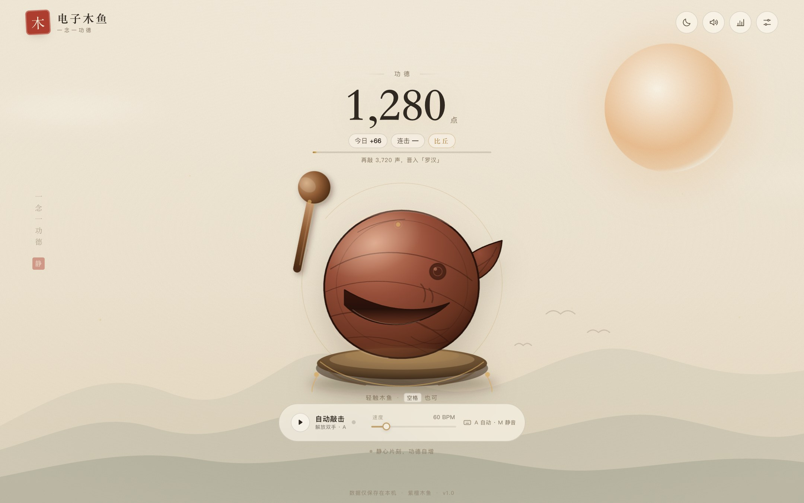
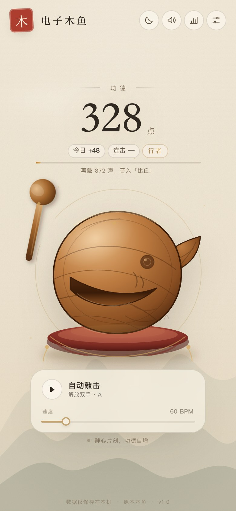
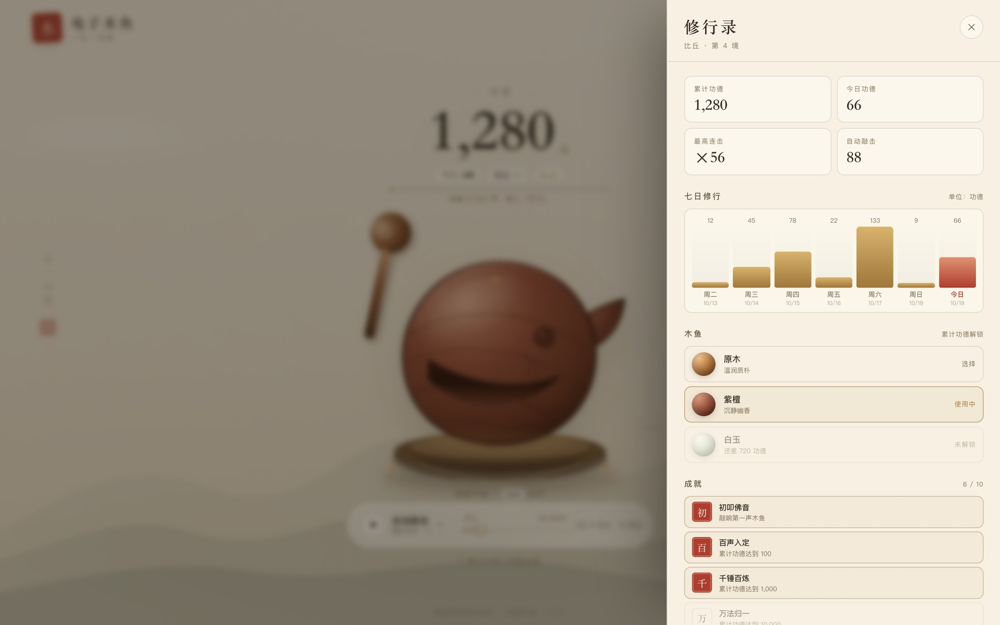
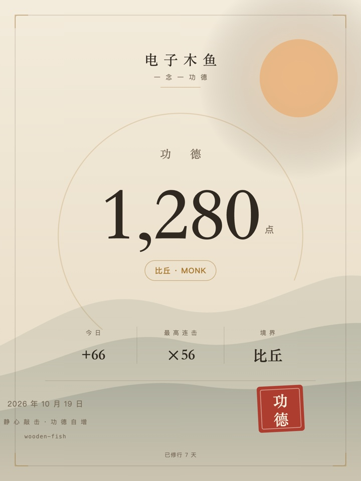

# 电子木鱼 · 一念一功德

一个安静、好看、能真正敲出声音的网页木鱼。轻触木鱼，功德 +1；也可以交给自动敲击，去泡一杯茶。

**在线体验**：<https://kaixinxiaobao7-ops.github.io/wooden-fish/>

纯前端实现：无后端、无账号、无追踪，所有功德只存在你自己的浏览器里。

<p align="center">
  
  
</p>

## 功能

- **敲击**：点击 / 触摸木鱼，或按空格键。按压缩放、涟漪、飞屑、`+1` 飘字、木槌挥动同步发生。
- **音效**：木鱼、铜磬、电子三种音色，全部由 Web Audio 实时合成，没有音频文件；每一声都有轻微随机变化，不机械。
- **功德系统**：累计功德、今日功德、连击、最高连击，从「初心」到「佛陀」共七重境界。
- **自动敲击**：30–240 BPM 可调，一键解放双手。
- **修行录**：最近七天的功德柱状图、10 枚成就、三款木鱼皮肤（原木 / 紫檀 / 白玉，按累计功德解锁）。
- **功德卡**：用 Canvas 生成一张当日修行卡片，保存为 PNG 分享。
- **日夜双主题**：宣纸日间与墨月夜间，首次访问会跟随系统偏好。
- **移动端适配**：安全区、触摸反馈、横竖屏响应式；可添加到主屏幕。
- **体面地动**：支持「减少动效」、振动反馈、音量调节，键盘可达，遵循 `prefers-reduced-motion`。

<p align="center">
  
  
</p>

快捷键：`空格` / `Enter` 敲击 · `A` 自动敲击 · `M` 静音 · `Esc` 关闭面板。

## 本地运行

需要 Node.js 20+。

```bash
npm install
npm run dev       # http://localhost:5173
npm run build     # 类型检查 + 生产构建，产物在 dist/
npm run preview   # 预览生产构建
```

## 部署到 GitHub Pages

仓库已包含 GitHub Actions 工作流 [`.github/workflows/deploy.yml`](.github/workflows/deploy.yml)：

1. 在 GitHub 新建仓库并推送到 `main` 分支。
2. 进入仓库 **Settings → Pages**，将 **Source** 设为 **GitHub Actions**。
3. 之后每次推送到 `main`，工作流会自动构建并发布；也可以手动触发 **Deploy to GitHub Pages**。

本项目当前部署在 <https://kaixinxiaobao7-ops.github.io/wooden-fish/>。Vite 使用相对路径构建（`base: './'`），因此仓库名、自定义域名和子路径部署都无需改配置。

## 技术栈

- [React 19](https://react.dev/) + TypeScript
- [Vite 6](https://vite.dev/)
- 原生 SVG 绘制木鱼与木槌，CSS 变量驱动皮肤与主题
- Web Audio API 实时合成三种音色（含程序生成的短混响）
- Canvas 2D 生成功德卡
- `localStorage` 持久化（键名 `wooden-fish.v1`）

## 目录

```
src/
  App.tsx                 主界面、敲击逻辑、自动敲击、快捷键
  components/
    WoodenFish.tsx        木鱼 SVG 与木纹、雕纹
    Mallet.tsx            木槌 SVG
    StatsSheet.tsx        修行录（统计 / 皮肤 / 成就 / 分享）
    SettingsSheet.tsx     设置
    Sheet.tsx             原生 <dialog> 抽屉
    Toasts.tsx            成就与提示
    Icons.tsx             线性图标
  lib/
    game.ts               等级、成就、皮肤、存档与统计
    audio.ts              Web Audio 合成器
    share.ts              Canvas 功德卡
  styles.css              主题、布局、动效、响应式
public/                   图标与 PWA manifest
.github/workflows/        GitHub Pages 自动部署
```

## 隐私

不使用 Cookies、分析工具或任何外部请求。功德、设置与成就保存在浏览器 `localStorage` 中；在设置里「清空所有功德」或在浏览器中清除站点数据即可删除。

## License

[MIT](LICENSE)
